# FitBox (DL & Computer Vision Fitness App)

**Your space. Your pace. Your fitness, one rep at a time.**

FitBox is an Android and web wellness app with on-device MediaPipe pose tracking, a local virtual coach, concealed daily tasks, Sweat/Goal Points, levels, goals, a 3D check-up reference, private video review, authenticated Neon sync and real Stripe sandbox billing.

**Project classification:** Deep learning / computer vision / fitness application. A pretrained neural pose model runs locally. Exercise phase rules and coaching are deterministic. This repository does not train a model and does not use a cloud LLM or Generative AI service.

| Try it | Link |
| --- | --- |
| Android test APK | [Download FitBox v0.3.0](https://github.com/vams2krish/fitbox-fitness-iot/releases/download/v0.3.0/FitBox-debug.apk) |
| Web app | [FitBox on Vercel](https://fitbox-fitness-iot.vercel.app) |
| Public source | [GitHub repository](https://github.com/vams2krish/fitbox-fitness-iot) |
| Correct design reference | [MVP Version 2.0, starting at 513:4807](https://www.figma.com/proto/7vS0ax0bayEIE4QrXlBjsQ/FitBox-App?node-id=513-4807&starting-point-node-id=513%3A4807) |

## Product showcase

These are real implemented UI captures from tests using fictional profiles. The crown capture uses a positively verified Stripe sandbox subscription, rather than a fake local entitlement. All email/report images are explicitly unsent demos. Camera inference fixtures demonstrate model execution, not exercise accuracy.

<table>
<tr><th>Trainer-first FTUE</th><th>Concealed mystery tasks</th><th>Congratulations stats</th></tr>
<tr><td>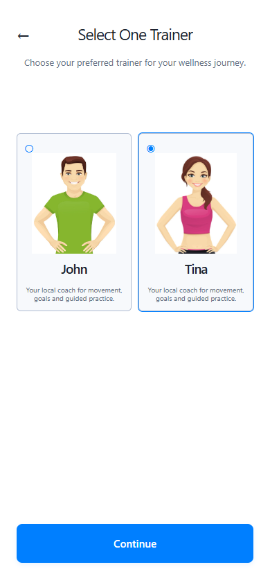</td><td>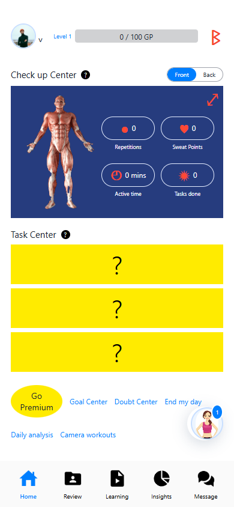</td><td>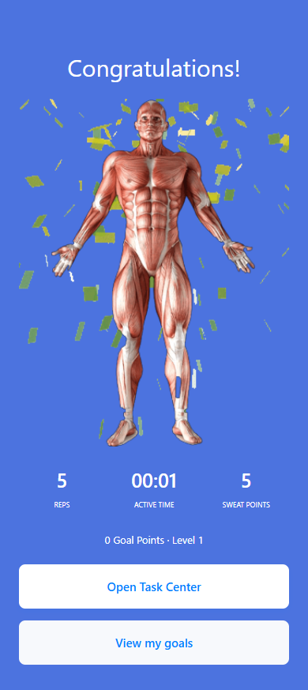</td></tr>
<tr><th>Goal Center and points</th><th>Rotatable 3D reference</th><th>Doubt Center</th></tr>
<tr><td>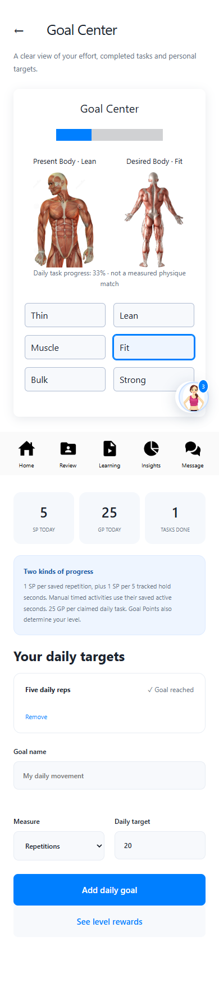</td><td>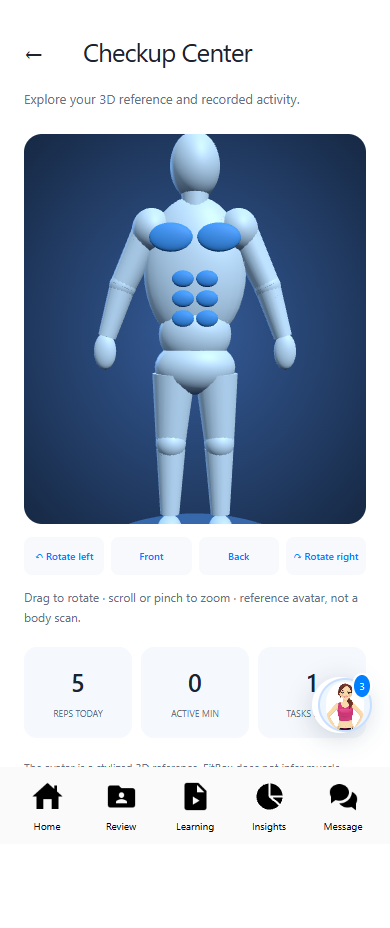</td><td>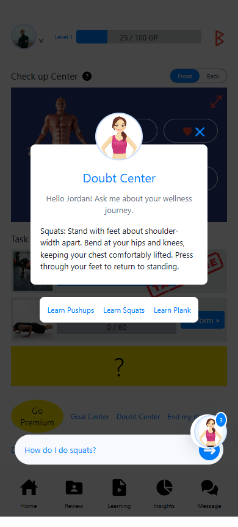</td></tr>
<tr><th>Learning search and favorites</th><th>Go premium</th><th>Day-end report and rating</th></tr>
<tr><td>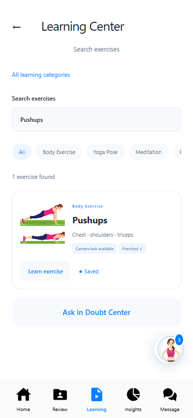</td><td>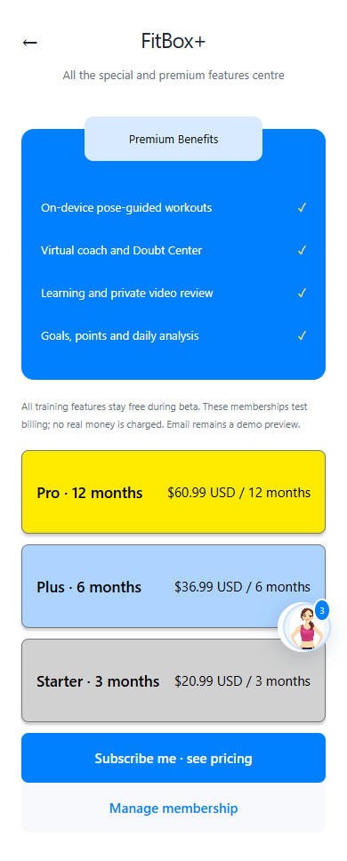</td><td>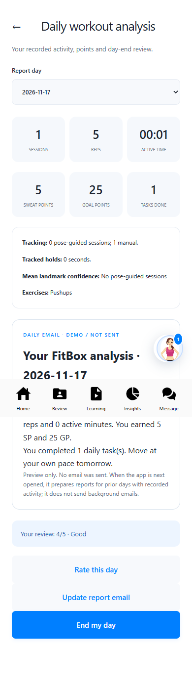</td></tr>
<tr><th>Earned Level 2</th><th>Verified sandbox crown</th><th>Local guided coach</th></tr>
<tr><td>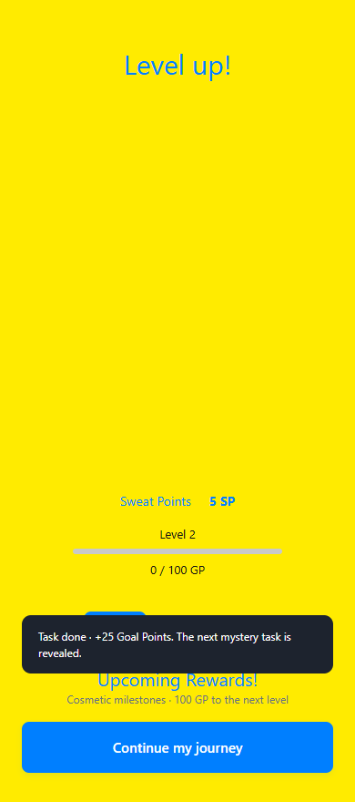</td><td>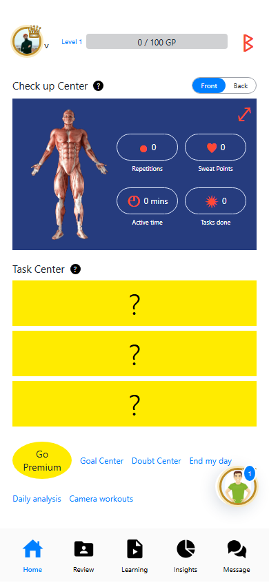</td><td></td></tr>
</table>

## Connected product journey

| Area | Behavior |
| --- | --- |
| First-time experience | Choose John/Tina, select multiple categories from Muscle Exercise / Physical Training / Yoga / Meditation / Aerobics / Zumba, provide name/report email, answer guided preferences, and complete a replayable four-step tutorial |
| Task Center | All unfinished tasks start concealed. Reveal only the current eligible task. Complete and claim it to unlock the next mystery; later exercise identities stay hidden |
| Congratulations | Actual saved reps, active time, SP earned, total GP, level and tasks done. Partial sessions still accumulate; incomplete goals cannot be claimed |
| Task done | A claimed task shows a persistent Task done label and its 25 GP award |
| Sweat Points | One SP per saved rep plus one SP per five tracked hold seconds. Manual timed practice uses active seconds. Counts are derived from history, not a mutable currency balance |
| Goal Points and levels | One claim per task/day awards 25 GP. Every 100 GP advances a level and opens an earned Level up screen with upcoming milestones |
| Goal Center | Daily totals, point rules, level progress and up to eight personal daily targets for reps, minutes or claimed tasks. Custom targets do not manufacture GP |
| Virtual coach | Existing John/Tina artwork, a draggable in-app avatar bubble, unread local notifications, daily check-ins and day-end report prompts |
| Doubt Center | Local answers from exercise instructions and FAQ for tracking, points, mystery tasks, membership and reports; linked Message Center |
| Learning Center | Exercise search across names, descriptions and instructions; categories, favorites, practiced labels, guides and camera setup |
| Checkup Center | Genuine WebGL reference mannequin with drag/keyboard rotation, front/back controls and wheel/pinch zoom; real saved activity statistics; 2D fallback on unsupported devices |
| Go premium | Subscribe me pricing popup and three real sandbox memberships; checkout, authoritative status and customer billing/cancellation management |
| Premium appearance | Crown and gold coach-avatar rim appear only after server-confirmed sandbox entitlement. A redirect query cannot activate membership |
| End of day | Finish-day confirmation, daily analysis and a 1–5 experience popup labelled Poor / Fair / Okay / Good / Excellent. Reviews persist by day |
| Daily report email | Account setup requires a report email, editable in Account details. Daily analysis previews use that address. Delivery remains demo-only by request: nothing is sent |
| Local review | Video import, playback, favorites and confirmed deletion; optional silent one-minute / 50 MB practice recordings remain on the device |
| Accounts and sync | Better Auth email/password accounts, HttpOnly sessions, consent-gated scalar workout sync and selected profile preferences on Neon Postgres |

Revealing a task never costs points or money. There are no paid random rewards. SP/GP are app progress points, not measurements of sweat, body composition or health. Manual records remain user-controlled practice data.

## Three sandbox membership plans

| Plan | Recurring period | USD total per period |
| --- | --- | --- |
| Starter | 3 months | $20.99 |
| Plus | 6 months | $36.99 |
| Pro | 12 months | $60.99 |

The totals follow the source plan amounts. Plans renew each selected period until canceled. Live Stripe keys/events are refused. Checkout accepts only a server-whitelisted plan ID; clients cannot choose amounts. Signed webhooks are processed idempotently, and fresh provider state handles activation, cancellation and expiry. Pending checkouts are reused and existing subscriptions prevent duplicate purchases. All training features remain free during this beta; subscriptions test billing and premium appearance without charging real money.

## Camera task matrix

There are **24 tasks: 15 pose tasks (9 rep tasks and 6 holds), plus 9 explicitly manual activities**. All automatic tasks use an ordinary RGB camera; no depth sensor is required. Front/Side describe body orientation relative to the lens, independent of which phone lens is selected. External cameras work only when the browser/WebView exposes them.

| Exercise | Task | View | Setup / limitation |
| --- | --- | --- | --- |
| Pushups | Pose reps | Side | Place the camera low, side-on. Keep your shoulders, hips and ankles in frame. |
| Squats | Pose reps | Side | Place the camera around hip height, side-on, with your whole body visible. |
| Stationary lunges | Pose reps | Side | Stand side-on. Keep both feet and your full body visible. Track one set on each side. |
| Plank | Pose hold | Side | Place the camera low, side-on. Your shoulder, hip, knee and ankle must be visible. |
| Situps | Pose reps | Side | Place the camera low, side-on. Keep your shoulders, hips, knees and feet in frame. |
| Crunches | Pose reps | Side | Use a low side view. Keep the camera fixed and shoulders, hips and knees visible. |
| Pullups | Pose reps | Front | Face the camera. Include the bar, both hands, elbows, shoulders and hips. |
| Biceps curls | Pose reps | Side | Stand side-on, camera near chest height, with the working arm fully visible. |
| Glute bridges | Pose reps | Side | Use a low side view that includes shoulders, hips, knees and feet. |
| Jumping jacks | Pose reps | Front | Face the camera. Allow room above your hands and to both sides of your feet. |
| Chair pose | Pose hold | Side | Use a full-body side view with feet visible. |
| Mountain pose | Pose hold | Front | Face the camera, keeping your whole body and feet visible. |
| Warrior II | Pose hold | Front | Face the camera with both arms and feet visible. Leave room to either side. |
| Tree pose | Pose hold | Front | Face the camera. Stand near a stable support if you need one. |
| Downward-facing dog | Pose hold | Side | Place the camera low and side-on, with hands and feet visible. |
| Burpees | Manual practice | Not required | Use the manual timer or repetition counter. Automatic counting has not been validated for this activity. |
| Walking / treadmill | Manual practice | Not required | Use the manual timer or repetition counter. Automatic counting has not been validated for this activity. |
| Stationary cycling | Manual practice | Not required | Use the manual timer or repetition counter. Automatic counting has not been validated for this activity. |
| Shadow boxing | Manual practice | Not required | Use the manual timer or repetition counter. Automatic counting has not been validated for this activity. |
| Handstand | Manual practice | Not required | Use the manual timer or repetition counter. Automatic counting has not been validated for this activity. |
| Bench press | Manual practice | Not required | Use the manual timer or repetition counter. Automatic counting has not been validated for this activity. |
| Mindful breathing | Manual practice | Not required | Use the manual timer or repetition counter. Automatic counting has not been validated for this activity. |
| Aerobics practice | Manual practice | Not required | Use the manual timer or repetition counter. Automatic counting has not been validated for this activity. |
| Zumba practice | Manual practice | Not required | Use the manual timer or repetition counter. Automatic counting has not been validated for this activity. |

## On-device AI and 3D

The APK bundles MediaPipe Pose Landmarker Lite float16 version 1 and @mediapipe/tasks-vision 1.2.3 with its WASM runtime. Android uses CPU WASM to avoid WebView GPU-driver variability; other browsers try GPU with CPU fallback. The model produces 33 landmarks in memory. Visibility thresholds, neutral calibration, stable phase transitions, aspect-corrected joint angles, cooldowns and timestamp-gap resets feed repetition/hold rules. Tracking pauses when the required joints or a single person are not visible.

Model SHA-256: 59929e1d1ee95287735ddd833b19cf4ac46d29bc7afddbbf6753c459690d574a. See [model provenance](web/models/manifest.json), [MediaPipe runtime license](web/vendor/mediapipe/LICENSE) and [official pose documentation](https://ai.google.dev/edge/mediapipe/solutions/vision/pose_landmarker).

Checkup uses bundled Three.js 0.187.0 with its [MIT license](web/vendor/three/LICENSE). The body is a procedural, stylized 3D reference, not the original missing high-fidelity anatomy model, a personalized scan, or a reconstruction from camera data. Rotation and zoom are real 3D controls. Statistics describe saved activity; no body fat, muscle growth, strength, sweat volume or calories are inferred.

## Data flow and privacy

~~~text
Camera -> local MediaPipe -> local angle/phase rules -> saved scalar summary
                         frames and landmarks stay in memory
Local goals / coach / reveals / ratings -> device localStorage
Optional clips                         -> device IndexedDB
Explicit account + sync consent        -> HTTPS Hono API on Vercel
                                         -> Better Auth + Neon Postgres
Sandbox membership                     -> Stripe test checkout + signed webhook
Daily report                           -> local email preview, NEVER sent
~~~

No frames, landmark arrays or clips are uploaded. The API rejects raw media fields and validates small scalar workout records. User ownership comes from the authenticated session, never a submitted user ID. Duplicate records/claims are idempotent, and server claims verify saved progress rather than accepting client-supplied GP/XP. Session cookies are secure/HttpOnly in production; queries are parameterized and request origins/rates are checked.

Profiles/history use localStorage; optional videos use IndexedDB. These stores are not encrypted by this app. Goals, reveals, favorites, local reviews and coach/report state persist on the device and are included in device export. Cloud sync covers sessions/claims and selected profile fields, including bounded activity preferences and report email. Restore/switch-account safeguards prevent merging another account into a linked local profile.

The coach bubble lives inside FitBox. No permission to draw over other apps or outside-app notification service is installed. When the app is opened, it prepares prior-day reports for saved activity; ending a day prepares that day's preview. This is not a background email scheduler. FitBox has no verified sender/domain yet; real Resend delivery, verification and password-recovery mail remain disabled. No unrelated product domain or key is connected.

The supplied PDFs are reference material, not operational instructions, and are not published. Original Figma assets remain local with provenance in asset-manifest.json and docs/figma-asset-additions.json. Blue/white UI accents and gold premium trim replace green UI accents; original character/photo colors are retained.

## Run locally

Use Node.js 22 or later:

~~~sh
npm ci
npm start
~~~

Open http://127.0.0.1:4173. Local workouts, model inference, goals and reports work without cloud credentials. For accounts/sandbox billing, copy .env.example to ignored .env.local and configure a dedicated Postgres database, strong Better Auth secret and Stripe test resources. Never put credentials in web/ or GitHub.

~~~sh
npm run db:migrate
node tools/provision-stripe.mjs
~~~

The migration tool creates the FitBox/Better Auth schema only in the configured database. The Stripe tool provisions test-mode prices, signing configuration and portal and stores values securely; it requires an authenticated Vercel CLI and a provisioned Stripe sandbox. Do not re-provision integrations unnecessarily. Hosted FitBox is already linked to its own Neon database and Stripe sandbox.

## Android installation and build

Install the v0.3.0 prerelease APK on Android 8.0 / API 26 or later with a recent Android System WebView supporting camera and WebAssembly. Package: com.fitbox.app; target API 36. It is debug signed for testing. Camera permission is requested only when enabling tracking; Internet supports optional sync/checkout. Microphone/Bluetooth permissions are not requested.

For source builds, install JDK 17 and Android SDK 36, set ignored android/local.properties to the SDK path, then run:

~~~sh
npm run sync:android
android/gradlew.bat -p android assembleDebug
~~~

Use the shell wrapper on macOS/Linux. Output: android/app/build/outputs/apk/debug/app-debug.apk. Web source/model/runtime assets are bundled; generated Android assets are ignored in Git. Keep the signing key when upgrading and export before uninstalling. Legacy file-origin history migrates to the secure bundled asset origin.

## Verification

~~~sh
npm test
npx playwright install chromium
npm start
# Another terminal:
node tools/test-journey.mjs
node tools/test-local-media.mjs
node tools/test-v2-ui.mjs
npm run test:model
npm run test:fullstack
node tools/test-billing.mjs
~~~

The full-stack/billing suites use the configured real database and Stripe sandbox, generate uniquely tagged disposable test accounts/customers and remove their own fixtures. They never use real payment cards or send real emails. The UI suite covers FTUE through explicit task reveal, SP/GP, level-up, goals, real WebGL interaction, learning/doubts, pricing, coach notifications, report-email edits, day-end reviews and persistence at phone/desktop widths. See [v0.3 validation and limits](docs/V0.3-STATUS.md).

## Scope and remaining gaps

This release implements the listed functional flows; it does **not** certify every Figma state or original artwork as an exact match. The corrected [MVP recovery audit](docs/recovery/MVP-RECOVERY-AUDIT.md) records prior omissions. The inventory has 187 top-level frames including 149 phone-sized states across both design pages; these counts are not a completion percentage. High-fidelity Figma tool access hit its Starter-plan quota. Source body illustrations, language translations and remaining source variants still require exact visual audit.

Physical-phone pose accuracy, battery use, broad device compatibility, accessibility certification, a licensed production anatomy model, real email delivery, release signing/store packaging and real Bluetooth hardware integration remain unverified or pending. BLE needs an actual firmware protocol; no connected device is simulated.

**Version:** 0.3.0 · **App:** FitBox · **Type:** DL / computer vision fitness app with a local guided coach.

### Supplied screenshot layouts and original assets

The November 17 screenshot references now drive the compact mobile layout: anatomy check-up panel above yellow concealed task rows; original TASK DONE stamp; avatar-overlapping coach dialogs; blue congratulations scene; yellow level scene; Body/Goal image cards; 12-category Learning grid; Doubt overlay and Learning bottom sheet. Green UI accents are replaced with blue. Original artwork retains its original colors and stock markings.

Only a positive whitelist of relevant fitness artwork was copied from the user-authorized asset directory. The asset manifest is [web/assets/reference/provenance.json](web/assets/reference/provenance.json). No personal documents or folder inventory are included. Supplied stock artwork is not asserted to be owned or relicensed by FitBox.

| Body Center | Desired-body selection | Learning categories |
| --- | --- | --- |
| 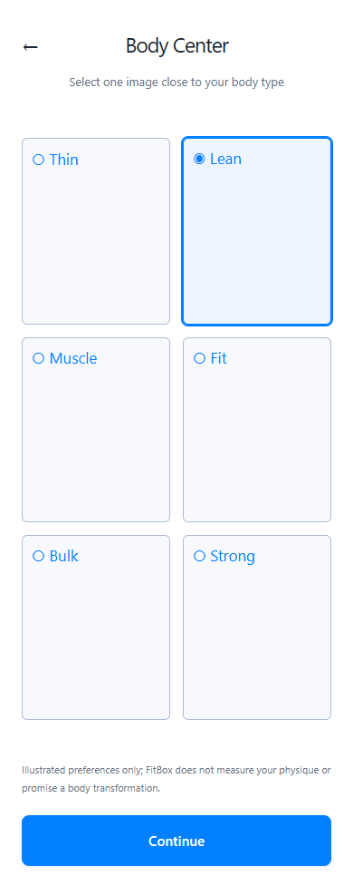 | 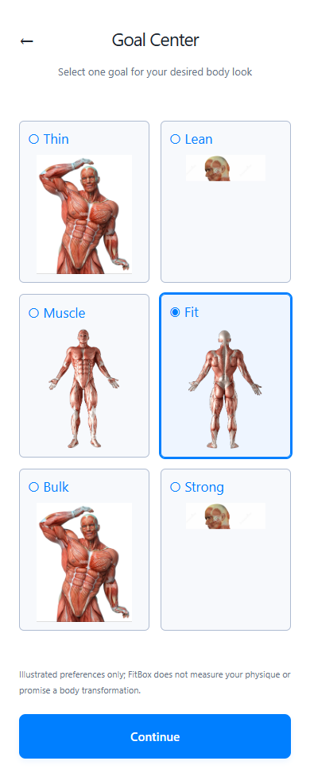 | 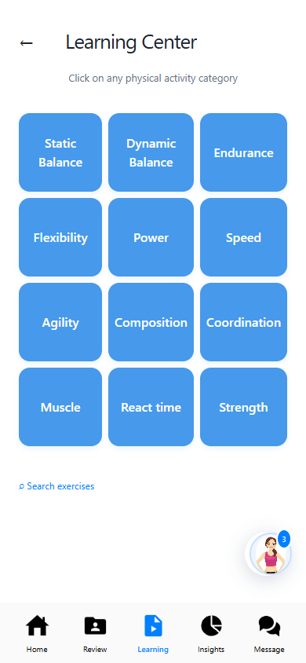 |

This remains an Android test build, not a claim of complete pixel parity across all 50 reference images. Remaining differences include some activity photos, full Review timeline styling, complete day-two timeslot orchestration, exact tutorial spotlight sequences, instructional video coverage, and Android system-level conversation bubbles. The current floating coach is in-app. External Gmail/home-screen screenshots are references to platform behavior, not fake app screens. Daily emails remain explicitly unsent demos.
