# FitBox (DL & Computer Vision Fitness App)

**Your space. Your pace. Your fitness, one rep at a time.**

FitBox is an Android and web fitness app with bundled **on-device MediaPipe pose inference**, a local guided trainer, workout goals, private video review, and optional authenticated text-summary sync to Neon Postgres. Its interface follows the supplied FitBox Figma design with blue and white UI accents.


**Project type:** Deep learning / computer vision / fitness application. MediaPipe's pretrained neural pose model runs locally; repetition and hold recognition use deterministic joint-angle rules. No model is trained by this repository. The trainer is a local guided assistant, with no cloud LLM or Generative AI dependency.

| Try it | Link |
| --- | --- |
| Android test APK | [Download FitBox v0.2.0](https://github.com/vams2krish/fitbox-fitness-iot/releases/download/v0.2.0/FitBox-debug.apk) |
| Web app | [FitBox on Vercel](https://fitbox-fitness-iot.vercel.app) |
| Source | [Public GitHub repository](https://github.com/vams2krish/fitbox-fitness-iot) |
| Design | [FitBox Figma prototype](https://www.figma.com/proto/7vS0ax0bayEIE4QrXlBjsQ/FitBox-App?node-id=364-3661) |

## What works

- Local profile and guided onboarding; trainer John or Tina; deterministic coaching based on workout records and camera setup.
- 22 exercise tasks: **15 pose tasks (9 repetition tasks and 6 timed holds)** and 7 explicitly manual activities.
- Front, rear and browser-visible external cameras; blue skeleton overlay; calibration, visibility checks, pause/resume, retry, and disposal when leaving the workout.
- Daily goals, cumulative partial sessions, one 25 XP claim per exercise/day, levels, streaks, voluntary rest, insights, and front/back anatomy reference views.
- Sequential Task Center, Body Center preferences, account details, feedback, and exercise instructions.
- Review Center: import, play, favorite and delete local videos; optional silent practice clips capped at one minute / 50 MB. Videos remain in device IndexedDB.
- Email/password accounts, HttpOnly sessions, explicit sync consent, restore and sign-out. The backend validates small scalar summaries and checks ownership on every query.
- Offline packaged Android UI, model and WASM runtime; native camera permission, user-selected video picker and JSON sharing.
- Three real Stripe sandbox membership plans with checkout, subscription status and cancellation management; explicitly unsent email previews.

## Scope still pending

This is a functional **v0.2 testing release**, not a claim that every requested Figma state is complete. Stripe sandbox is connected with Starter (3 months / $20.99), Plus (6 months / $36.99) and Pro (12 months / $60.99) plans, authenticated checkout, signed idempotent webhooks, authoritative membership status and billing management/cancellation. All prices are USD totals per recurring period. No real money is charged, and all training features remain free during beta.

Email is **demo-preview only**, as requested until FitBox has its own sender/domain. Welcome and workout-summary previews never send messages. Resend delivery, verification and recovery remain disabled. No unrelated product domain or email key is connected.

The Figma inventory contains 187 top-level frames, including 149 phone-sized screens/state frames. Detailed Figma access reached its tool quota. Existing extracted assets and browser-reviewed screens were used, but complete visual and interaction parity is **not certified**. Language translations, some level-up/tutorial overlays, exact body-choice illustrations and other state variants remain to audit. See [design coverage](docs/V0.2-STATUS.md) and the [complete source inventory](docs/figma-screen-inventory.json).

## Camera task matrix

All automatic tasks use an ordinary RGB camera; depth sensors are not required. “Front” and “Side” describe the person's position relative to the lens, independently of the phone lens selected. Keep the required joints visible, use a fixed camera and one person in frame. These exercise rules are experimental and have not been validated against a physical exercise dataset.

| Exercise | Task | View | Camera placement / limitation |
| --- | --- | --- | --- |
| Pushups | Repetition phases | Side | Place the camera low, side-on. Keep your shoulders, hips and ankles in frame. |
| Squats | Repetition phases | Side | Place the camera around hip height, side-on, with your whole body visible. |
| Stationary lunges | Repetition phases | Side | Stand side-on. Keep both feet and your full body visible. Track one set on each side. |
| Plank | Timed pose hold | Side | Place the camera low, side-on. Your shoulder, hip, knee and ankle must be visible. |
| Situps | Repetition phases | Side | Place the camera low, side-on. Keep your shoulders, hips, knees and feet in frame. |
| Crunches | Repetition phases | Side | Use a low side view. Keep the camera fixed and shoulders, hips and knees visible. |
| Pullups | Repetition phases | Front | Face the camera. Include the bar, both hands, elbows, shoulders and hips. |
| Biceps curls | Repetition phases | Side | Stand side-on, camera near chest height, with the working arm fully visible. |
| Glute bridges | Repetition phases | Side | Use a low side view that includes shoulders, hips, knees and feet. |
| Jumping jacks | Repetition phases | Front | Face the camera. Allow room above your hands and to both sides of your feet. |
| Chair pose | Timed pose hold | Side | Use a full-body side view with feet visible. |
| Mountain pose | Timed pose hold | Front | Face the camera, keeping your whole body and feet visible. |
| Warrior II | Timed pose hold | Front | Face the camera with both arms and feet visible. Leave room to either side. |
| Tree pose | Timed pose hold | Front | Face the camera. Stand near a stable support if you need one. |
| Downward-facing dog | Timed pose hold | Side | Place the camera low and side-on, with hands and feet visible. |
| Burpees | Manual timer / counter | Not required | Use the manual timer or repetition counter. Automatic counting has not been validated for this activity. |
| Walking / treadmill | Manual timer / counter | Not required | Use the manual timer or repetition counter. Automatic counting has not been validated for this activity. |
| Stationary cycling | Manual timer / counter | Not required | Use the manual timer or repetition counter. Automatic counting has not been validated for this activity. |
| Shadow boxing | Manual timer / counter | Not required | Use the manual timer or repetition counter. Automatic counting has not been validated for this activity. |
| Handstand | Manual timer / counter | Not required | Use the manual timer or repetition counter. Automatic counting has not been validated for this activity. |
| Bench press | Manual timer / counter | Not required | Use the manual timer or repetition counter. Automatic counting has not been validated for this activity. |
| Mindful breathing | Manual timer / counter | Not required | Use the manual timer or repetition counter. Automatic counting has not been validated for this activity. |

## How on-device AI works

The APK bundles MediaPipe Pose Landmarker Lite, float16 version 1, plus @mediapipe/tasks-vision 1.2.3 and its WASM runtime. No cloud inference is used. Android uses CPU WASM to avoid WebView GPU-driver differences; other browsers try GPU with CPU fallback. The model produces 33 landmarks locally. Visibility must reach 0.65, phase changes must be stable, and tracking resets when a person leaves frame or timestamps jump. Aspect-corrected joint angles feed a state machine with neutral calibration and a repetition cooldown. Hold time only advances while its rule is satisfied.

The model checksum is `59929e1d1ee95287735ddd833b19cf4ac46d29bc7afddbbf6753c459690d574a`. [Model provenance](web/models/manifest.json), [runtime license](web/vendor/mediapipe/LICENSE) and [official model documentation](https://ai.google.dev/edge/mediapipe/solutions/vision/pose_landmarker) are included for inspection. Model inference was verified on an official static test image; this is not an exercise-accuracy benchmark.

### Data and privacy

Camera frames and per-frame landmarks stay in memory on the device. Only an explicit recording creates a local video. Optional cloud sync sends exercise IDs, timestamps, repetition/hold totals and aggregate confidence/tracking counts, along with the user's selected profile fields. The API rejects images, landmark arrays and unrecognized fields. Clips are excluded from sync and JSON export.

Profiles/history use localStorage; clips use IndexedDB. These stores are not encrypted by the app. Cloud credentials live only in deployment environment variables. Better Auth uses secure HttpOnly cookies in production, password hashing and database-backed rate limits. Queries derive user ownership from the session; duplicate sessions and reward claims are idempotent. Server reward logic checks saved progress rather than accepting client-supplied XP. Local pose/manual summaries are user-controlled and are not verified competitive scores or health records.

Anatomy art is a reference; no muscle growth, body fat, sweat, strength or clinical assessment is inferred. Green prototype UI accents were replaced with blue; source photos retain their original colors. Product PDFs are reference material, not operational instructions, and are not published in this repository.

## Architecture

```text
Android WebView / browser
  camera -> bundled MediaPipe -> local angle/phase rules -> saved summary
  local guided coach + goals + anatomy + review -> localStorage / IndexedDB
  explicit sign-in + sync consent -> HTTPS Hono API (Vercel)
                                   -> Better Auth + Neon Postgres
  video / frames / landmarks ------ stay on device
```

| Path | Purpose |
| --- | --- |
| web/pose-camera.mjs | Local camera and model lifecycle |
| web/pose-engine.js | Exercise definitions, phase rules and safe scalar summaries |
| web/features.js | Camera catalog, trainer and MVP navigation |
| web/local-media.js | Device-only video review and optional recording |
| web/cloud*.js | Account UI and consent-gated sync |
| server/ | Authentication, strict validation, migrations and Hono API |
| api/index.mjs | Vercel Function entry |
| android/ | Native permission, secure asset origin, video picker and sharing |
| tests/ and tools/test-*.mjs | Unit, real-model, database and browser verification |

## Run locally

Install Node.js 22 or later. Run `npm ci` and `npm start`, then open http://127.0.0.1:4173. Local workouts and camera tracking work without backend credentials. For accounts, copy .env.example to ignored .env.local, provision a dedicated Postgres database and a strong BETTER_AUTH_SECRET, then run `npm run db:migrate`. Migrations create the Better Auth and FitBox tables; run them only against a database intended for this app. Never put provider secrets in the web directory or public GitHub repository.

The hosted deployment is linked to a dedicated Neon database and a Stripe sandbox through Vercel. Stripe price, portal and webhook configuration are server-only environment variables. The setup tool provisions only test-mode resources and refuses live keys. Email credentials are absent while preview-only mode is selected. Re-provisioning integrations is not a prerequisite for running local camera features.

## Android installation and build

Download the APK from the v0.2.0 release and install it on Android 8.0 / API 26 or later. This is a debug-signed test build using package `com.fitbox.app`, target API 36. Camera permission is requested only when enabling tracking; microphone and Bluetooth permissions are not requested. Internet is used for optional accounts/sync. Keep the same signing key when upgrading; export local history before uninstalling.

To build: install JDK 17 and Android SDK platform 36, set ignored android/local.properties to your SDK path, run `npm run sync:android`, then `android/gradlew.bat -p android assembleDebug` (or the shell wrapper on Linux/macOS). Output: `android/app/build/outputs/apk/debug/app-debug.apk`. Bundled assets are generated from web/. The legacy file-origin localStorage is migrated once to the new secure asset origin to support camera/WASM and session cookies.

## Verification

```sh
npm test
npx playwright install chromium
npm start
# In another terminal:
npm run test:model
node tools/test-ui.mjs
node tools/test-v2-ui.mjs
node tools/test-product-flows.mjs
# Uses the configured real database; creates/deletes only tagged test accounts:
npm run test:fullstack
node tools/test-billing.mjs
```

18 unit tests, actual model inference, full-stack account isolation/sync, Stripe sandbox lifecycle tests and browser journeys passed during development. Billing tests create and remove only their own sandbox customers/subscriptions. See [validation details and limits](docs/V0.2-STATUS.md). Physical-phone exercise accuracy, battery use and broad device compatibility remain unmeasured. Hardware Bluetooth integration needs a real firmware protocol; no sensor connection is simulated.

## v0.2 screenshot showcase

These are actual implemented UI captures. The inference screenshot deliberately uses a static official MediaPipe test photo: it demonstrates model execution, not a real completed squat or accuracy result.

<table>
<tr><th>Camera exercises</th><th>Camera setup</th><th>Inference test fixture</th></tr>
<tr><td>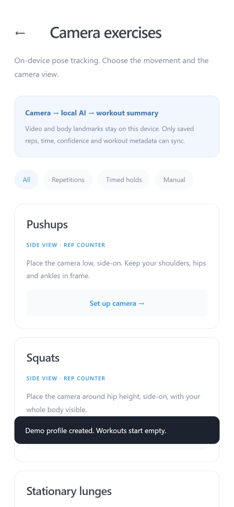</td><td>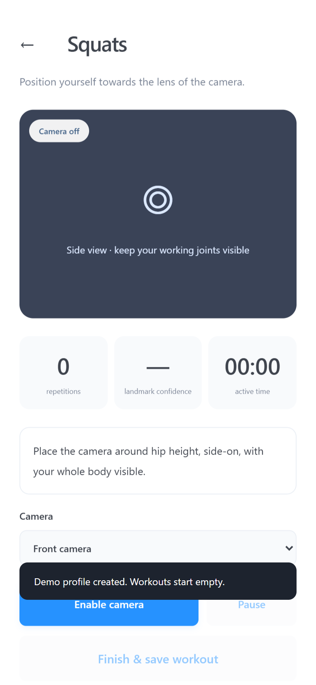</td><td>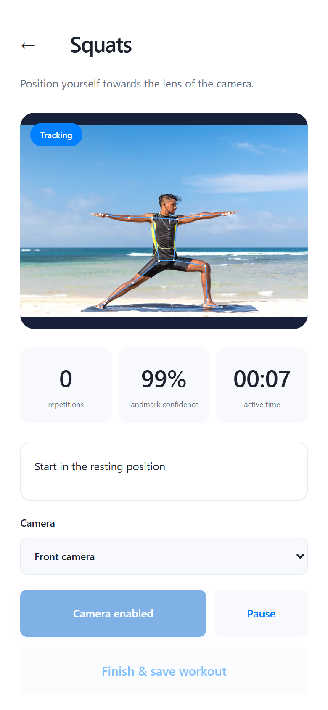</td></tr>
<tr><th>Local trainer</th><th>Cloud sync</th><th>Task Center</th></tr>
<tr><td>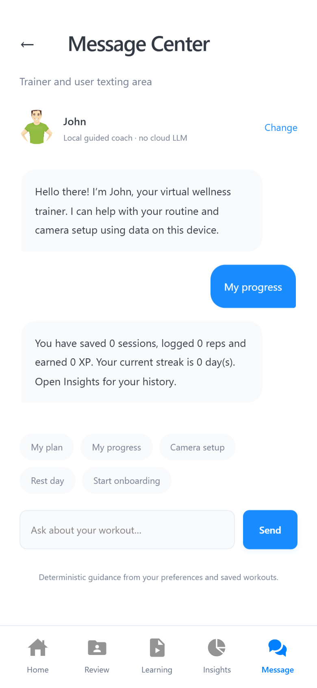</td><td>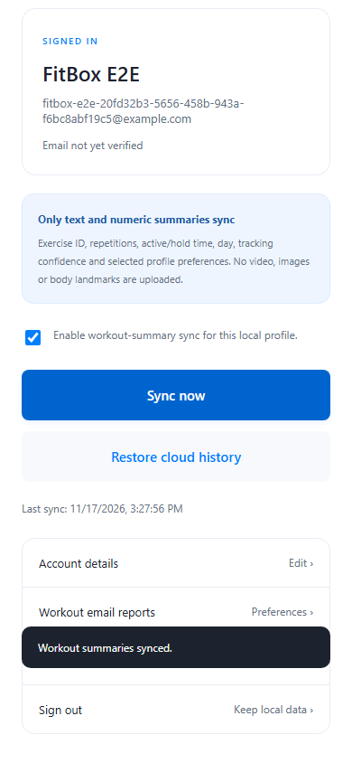</td><td>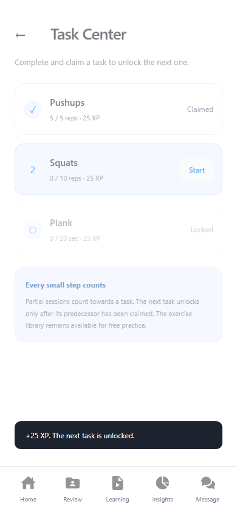</td></tr>
<tr><th>Check up Center</th><th>Review Center</th><th>Android camera</th></tr>
<tr><td>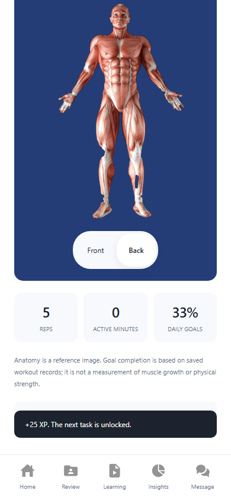</td><td>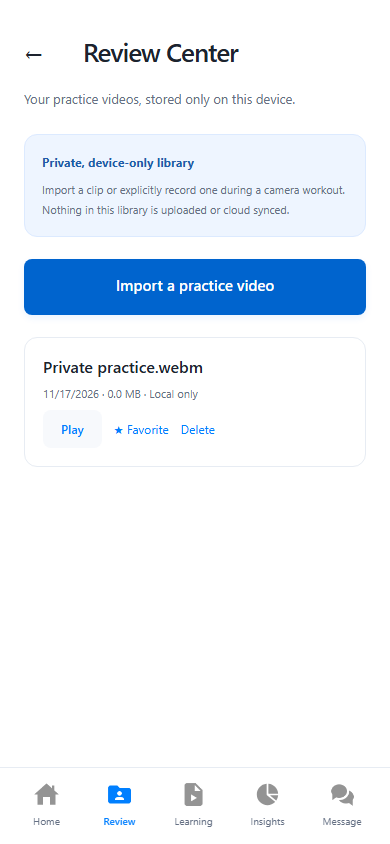</td><td>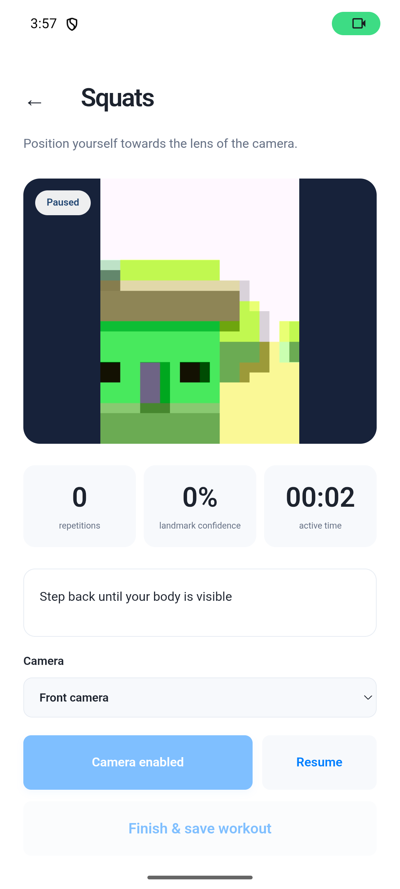</td></tr>
</table>

<p>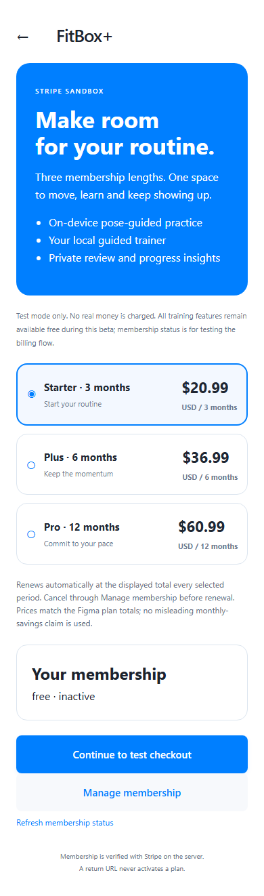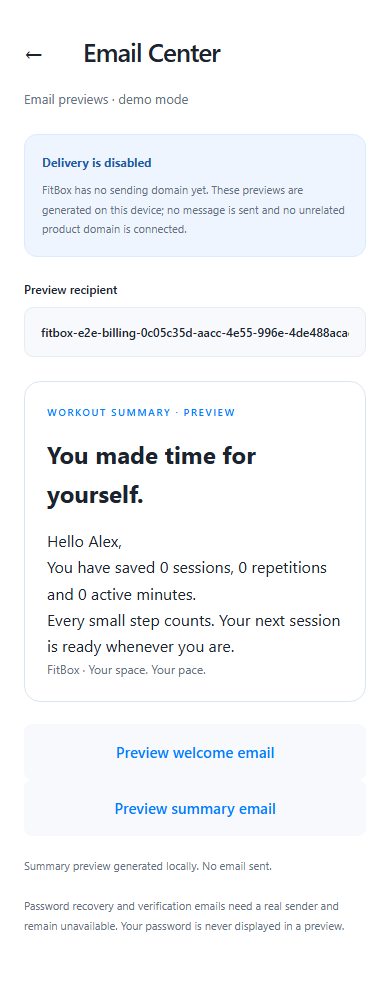</p>

## Screenshot showcase

These are actual screenshots of the implemented app, captured during automated browser testing. The example profile is fictional, and its workout data was entered through the UI. Android screenshots below are captured separately from the emulator.

<table>
  <tr><th>Welcome</th><th>Personalized onboarding</th><th>Choose an activity</th></tr>
  <tr><td>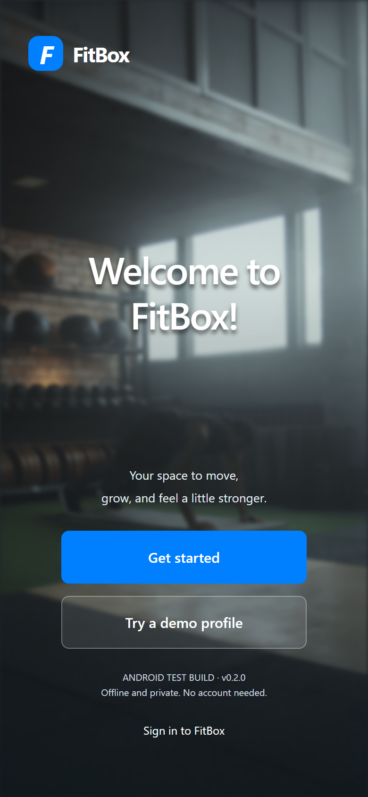</td><td>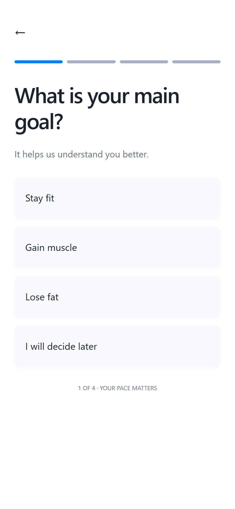</td><td>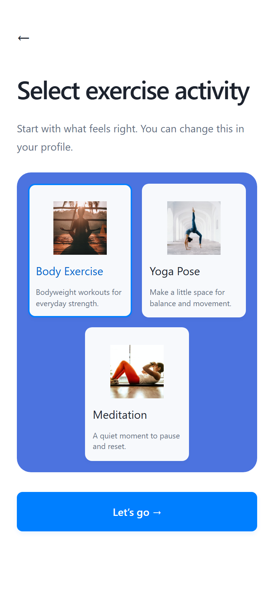</td></tr>
  <tr><th>Muscles · Front</th><th>Muscles · Back</th><th>Manual workout</th></tr>
  <tr><td>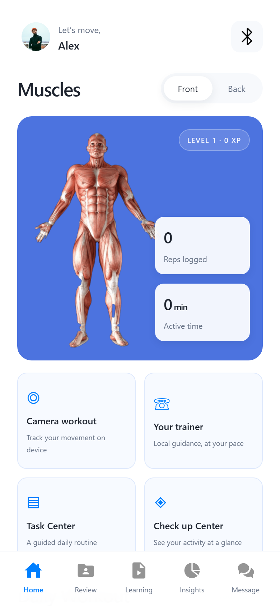</td><td></td><td></td></tr>
  <tr><th>Session saved</th><th>Activity insights</th><th>Exercise library</th></tr>
  <tr><td></td><td></td><td>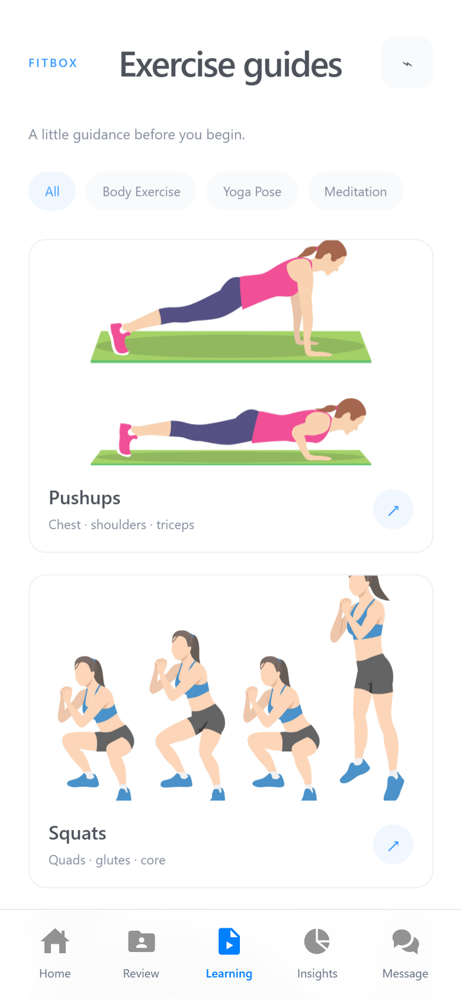</td></tr>
  <tr><th>Exercise instructions</th><th>Profile & rewards</th><th>Device status</th></tr>
  <tr><td>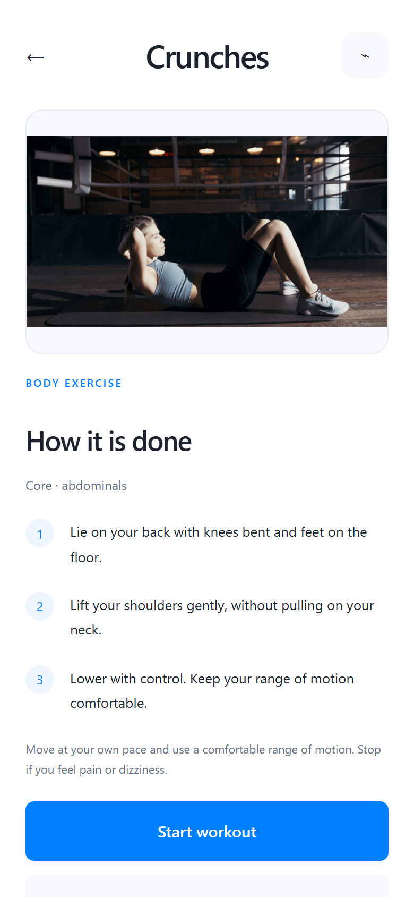</td><td>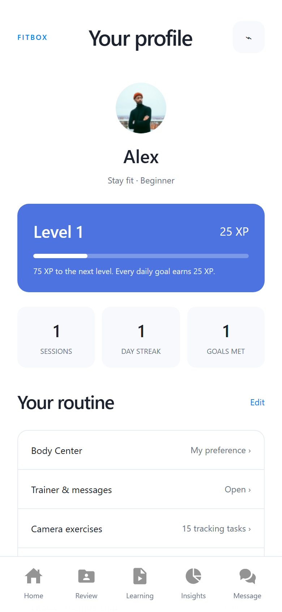</td><td>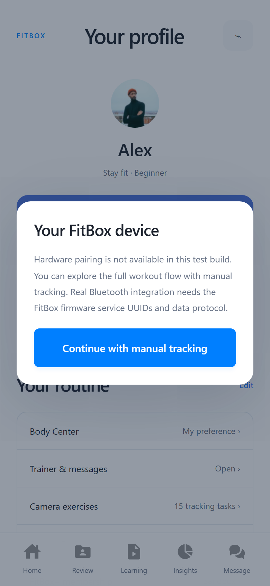</td></tr>
  <tr><th>Rest day</th><th colspan="2">Desktop web preview</th></tr>
  <tr><td></td><td colspan="2"></td></tr>
</table>

### Android emulator screenshots (v0.1 baseline)

<p>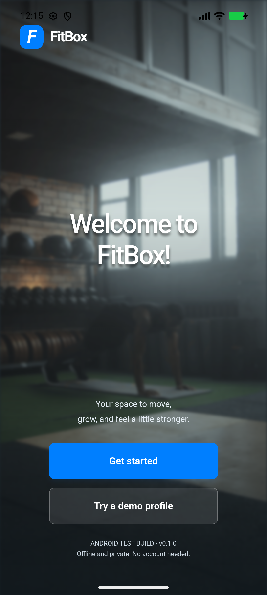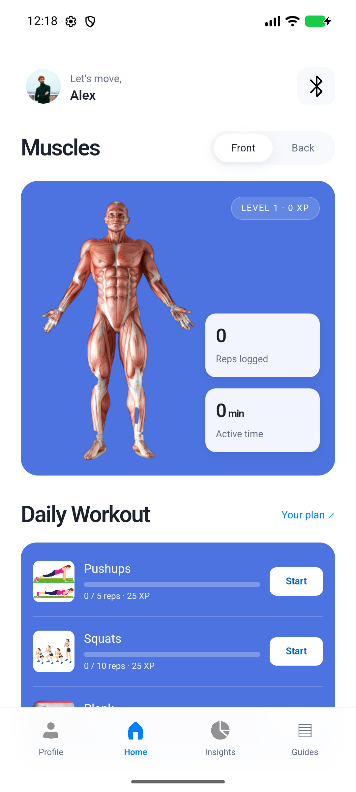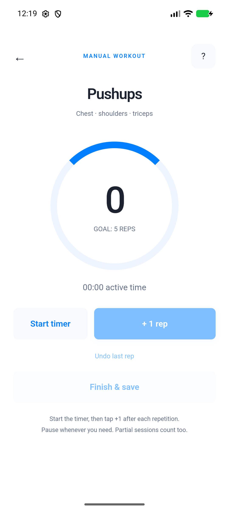</p>


**Version:** 0.2.0 · **App name:** FitBox · **Classification:** DL / computer vision with a local guided coach.
