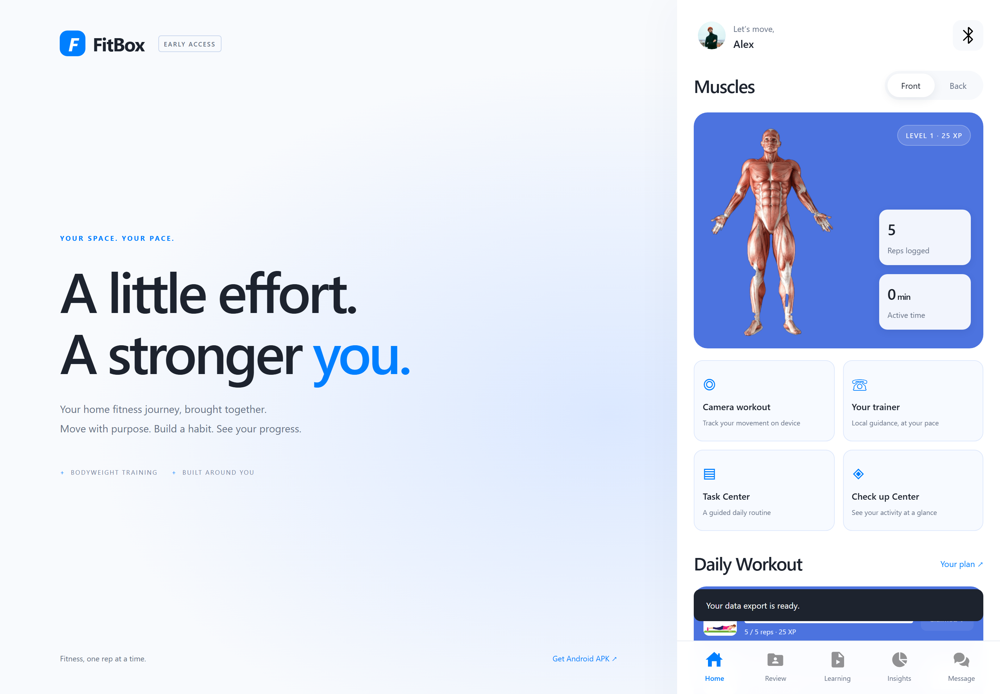
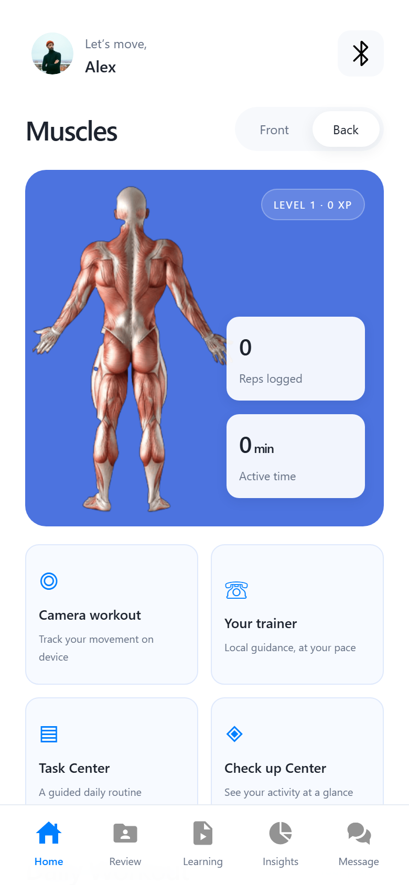
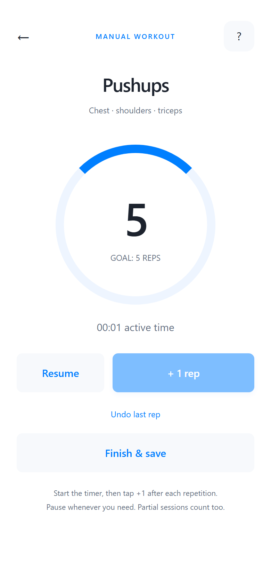
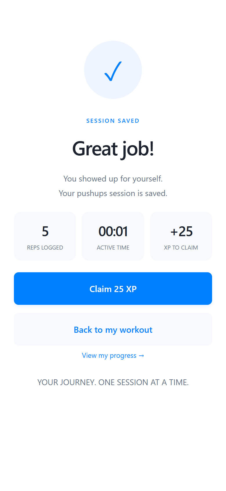
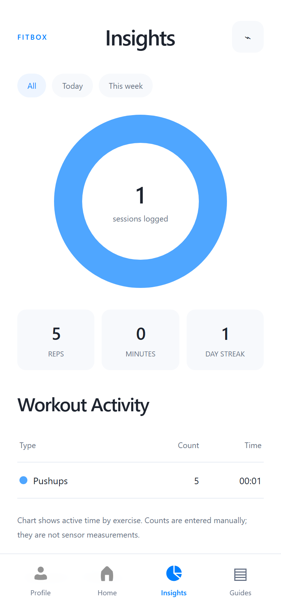
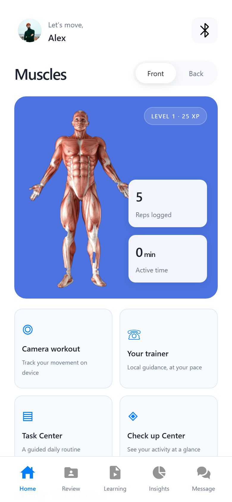

# FitBox — Fitness IoT & Android App

**Your space. Your pace. Your fitness, one rep at a time.**

FitBox is an offline-first home fitness companion, built from the supplied FitBox Figma prototype and product notes. It brings onboarding, daily workout goals, muscle anatomy views, exercise instructions, manual tracking, and habit rewards into an installable Android test app and a responsive web preview.



**Project type:** Fitness technology / IoT companion / Android & web application.  
**AI classification:** This release is **not an ML, DL, or Generative AI project**. It includes no trained model or inference pipeline. Computer vision and hardware-driven rep recognition are future integration work.

| Try it | Link |
| --- | --- |
| Android test APK | [Download FitBox v0.1.0](https://github.com/vams2krish/fitbox-fitness-iot/releases/download/v0.1.0/FitBox-debug.apk) |
| Interactive web preview | [Open FitBox on Vercel](https://fitbox-fitness-iot.vercel.app) |
| Design reference | [Original FitBox Figma prototype](https://www.figma.com/proto/7vS0ax0bayEIE4QrXlBjsQ/FitBox-App?node-id=364-3661) |
| Source | [Public GitHub repository](https://github.com/vams2krish/fitbox-fitness-iot) |

## What FitBox solves

Building a fitness habit at home can feel fragmented: choosing an exercise, understanding the movement, counting repetitions, and keeping a record all compete for attention. FitBox brings these steps together, with small goals and visible progress.

The wider product concept includes a dedicated camera-and-sensor device that communicates with a mobile app over Bluetooth. This release implements the software journey so it can be tested **without that device**. It records only what a person enters or times; it does not claim to detect their body, form, or calories.

## Screenshot showcase

These are actual screenshots of the implemented app, captured during automated browser testing. The example profile is fictional, and its workout data was entered through the UI. Android screenshots below are captured separately from the emulator.

<table>
  <tr><th>Welcome</th><th>Personalized onboarding</th><th>Choose an activity</th></tr>
  <tr><td></td><td></td><td></td></tr>
  <tr><th>Muscles · Front</th><th>Muscles · Back</th><th>Manual workout</th></tr>
  <tr><td></td><td></td><td></td></tr>
  <tr><th>Session saved</th><th>Activity insights</th><th>Exercise library</th></tr>
  <tr><td></td><td></td><td></td></tr>
  <tr><th>Exercise instructions</th><th>Profile & rewards</th><th>Device status</th></tr>
  <tr><td></td><td></td><td></td></tr>
  <tr><th>Rest day</th><th colspan="2">Desktop web preview</th></tr>
  <tr><td></td><td colspan="2"></td></tr>
</table>

### Android emulator screenshots

<p></p>

## Working features

| Area | Implemented behavior |
| --- | --- |
| Local onboarding | Name, goal, fitness level, available time, schedule, and preferred activity |
| Daily plan | Bodyweight goals scale by selected level; available time controls the number of tasks |
| Activity types | Body Exercise, Yoga Pose, and Meditation |
| Bodyweight exercises | Pushups, squats, plank, crunches, and stationary lunges |
| Timed activities | Plank, mountain pose, and mindful breathing |
| Muscle view | Front/back anatomical reference images from the Figma design |
| Rep tracking | Start the active timer, add repetitions, undo a repetition, pause/resume, and save |
| Timed tracking | Record active seconds; backgrounding the app pauses the timer |
| Partial sessions | Save unfinished goals and accumulate their progress during the same local day |
| Rewards | Claim 25 XP per completed daily task, once per task per day; level up every 100 XP |
| Streaks | Consecutive local calendar days with logged activity; rest days do not manufacture activity |
| Insights | Time distribution chart, repetition totals, active minutes, date filters, and recent session history |
| Exercise guides | Local images and step-by-step movement instructions |
| Rest days | Hide today's tasks and resume whenever ready |
| Profile management | Edit preferences, export data, or explicitly reset local data |
| Export | JSON download on web; native Android share sheet in the APK |
| Offline Android | All application code and visual assets are packaged inside the APK |

The saved schedule is a preference, not an automatic calendar or notification system. Goal selection is recorded in the profile; this prototype does not calculate individualized exercise prescriptions from a health assessment. Anatomy pictures are references, not measurements of muscle growth.

## Design approach

The app follows the linked original prototype's white surfaces, charcoal typography, bright blue primary actions (`#007FFF`), blue muscle/workout panels, rounded controls, front/back view, exercise imagery, and bottom navigation. **Green UI accents are replaced with blue.** Original Figma photos and illustrations retain their source colors.

The iOS-shaped prototype has been adapted for Android and responsive web: system bars are native on Android, controls fit smaller screens, navigation has text labels, and unavailable online login is replaced by an honest local profile flow. Guides contain images and written instructions rather than nonfunctional video buttons.

Design provenance and the reference-to-implementation mapping are in [docs/DESIGN.md](docs/DESIGN.md).

## Install the Android APK

1. Open the [v0.1.0 release](https://github.com/vams2krish/fitbox-fitness-iot/releases/tag/v0.1.0) on your Android phone.
2. Download **FitBox-debug.apk**.
3. Open the downloaded APK and allow that source to install it if Android asks.
4. Launch **FitBox**, then choose **Get started** or **Try a demo profile**.
5. Start a workout, start the timer, add repetitions, and select **Finish & save**. Claim XP after reaching a daily goal.

**Requirements:** Android 8.0 / API 26 or later. This is a debug-signed testing build, not a Play Store production release. It uses the package ID `com.fitbox.app`, targets API 36, and includes no camera, microphone, Bluetooth, or Internet permission.

Do not uninstall if you want to keep your local history. Export first. Browser and Android storage are separate; they do not synchronize.

## Run the web app locally

Install Node.js, then run:

```sh
npm ci
npm start
```

Open **http://127.0.0.1:4173**. Runtime code uses plain HTML, CSS, and JavaScript; there are no frontend framework dependencies or remote APIs. Playwright is a development-only dependency.

## Build the APK from source

Prerequisites: JDK 17, Android SDK platform 36, accepted Android SDK licenses, and Node.js.

```sh
npm run sync:android
```

Create an untracked `android/local.properties` pointing to your Android SDK:

```properties
sdk.dir=C:/Users/YOUR_USER/AppData/Local/Android/Sdk
```

Then build using the included Gradle wrapper:

```powershell
cd android
.\gradlew.bat assembleDebug
```

On macOS/Linux, use `sh ./gradlew assembleDebug` in the same directory. The output is `android/app/build/outputs/apk/debug/app-debug.apk`. The project pins Android Gradle Plugin 8.12.2 and Gradle 8.14.3.

Run `npm run sync:android` after changing the web app and before rebuilding. Generated Android assets are ignored by Git to keep one source of truth.

## Architecture

```text
                   Shared offline interface
                 web/index.html + styles.css
                              |
                         web/app.js
                  screens / timer / navigation
                              |
                         web/core.js
              plans / sessions / daily rewards / streaks
                              |
                 localStorage (fitbox.v1)
                    /                     \
         Browser preview             Android WebView
         Static Vercel host          Bundled local assets
         JSON download               Native share sheet
```

| Path | Purpose |
| --- | --- |
| `web/` | Shared app UI, local data layer, and bundled design assets |
| `android/` | Native Java Activity, application manifest, icon, and Gradle build |
| `tests/core.test.cjs` | Pure logic tests for goals, sessions, rewards, dates, and recovery |
| `tools/test-ui.mjs` | End-to-end browser flow checks and screenshot capture |
| `tools/sync-android.mjs` | Packages the shared web source inside the Android app |
| `tools/serve.mjs` | Local static development server |
| `docs/` | Screenshots, implementation details, validation, and roadmap |
| `vercel.json` | Static web deployment and response headers |

### Data model

Each device stores a versioned object containing `profile`, `sessions`, `claims`, `restDays`, and an optional onboarding `draft`.

Sessions include a unique ID, exercise ID, manually entered repetitions, active seconds, local calendar day, timestamp, and the source `manual`. Duplicate session IDs are rejected. Task rewards are keyed by day and exercise to prevent duplicate claims. Local data can be modified by the device owner and is not suitable for competitive leaderboards or verified health records.

## Privacy and security

- Profiles and workout history stay in browser/WebView local storage.
- No online authentication, analytics, advertising, third-party SDK, or backend database.
- No API key or service credential is required to run the app.
- User-entered names are escaped before rendering.
- Android loads only its bundled page and blocks in-WebView navigation to outside pages.
- The native bridge only shares JSON after the user chooses Export; it does not expose filesystem or device controls.
- Browser data is not encrypted by this application. Reset removes the local profile and history after a confirmation.
- Source product PDFs are not included in the public repository. The implemented assets originate from the user-supplied Figma file; no broader redistribution license for those assets is asserted.

## Tests and verification

```sh
npm test
npx playwright install chromium
npm start
# In another terminal:
node tools/test-ui.mjs
```

The browser suite covers onboarding, asset loading, repetition entry/undo, timer pause/resume, partial/timed sessions, saving, XP claims, reload persistence, insights, guides, rest days, export, reset, and horizontal overflow at widths 320, 375, 390, 480, and 1440 pixels. It captures the showcase screenshots through real UI interactions.

See [docs/VALIDATION.md](docs/VALIDATION.md) for the recorded build and test results and verification limits.

## Current limits and next steps

| Status | Capability |
| --- | --- |
| Working now | Offline profiles, manual/timed sessions, goals, rewards, guides, insights, export, APK, and web preview |
| Needs hardware protocol | BLE discovery/pairing, service and characteristic UUIDs, firmware messages, device identity, reconnect behavior, and live sensor events |
| Future computer vision | Camera capture, pose model selection, confidence thresholds, rep phase detection, form feedback, and real-world validation |
| Future backend | Secure accounts, family profiles, cloud sync, recovery, and authenticated device ownership |
| Future content | Licensed exercise videos, larger exercise library, adaptive programs, and instructor review |
| Future production release | Release signing, hardware testing, accessibility audit, device matrix, store packaging, and privacy disclosures |

Future camera pose estimation using a neural network would be a **DL/computer vision** feature; rule-based repetition counting over pose coordinates would be a separate algorithmic layer. Neither runs in this release. The broader concept is documented in [docs/ROADMAP.md](docs/ROADMAP.md).

## Project context

The supplied proposal, hardware notes, roadmap, miscellaneous notes, architecture, idea board, and habit research informed scope. They are treated as reference material, not operational instructions. This implementation emphasizes supportive progress and voluntary rest.

**Version:** 0.1.0 · **App name:** FitBox · **Repository:** `fitbox-fitness-iot` · **Type:** Fitness IoT & Android App.
