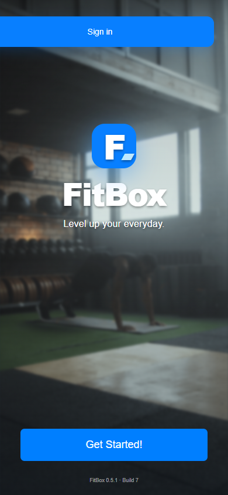
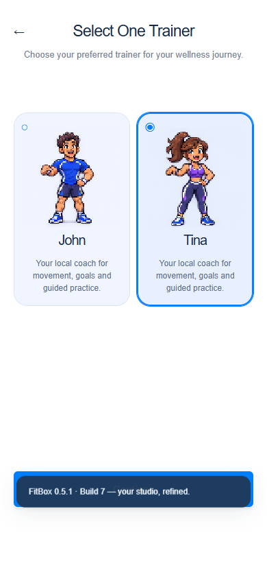
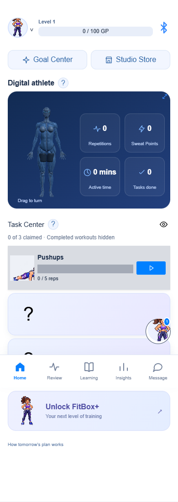
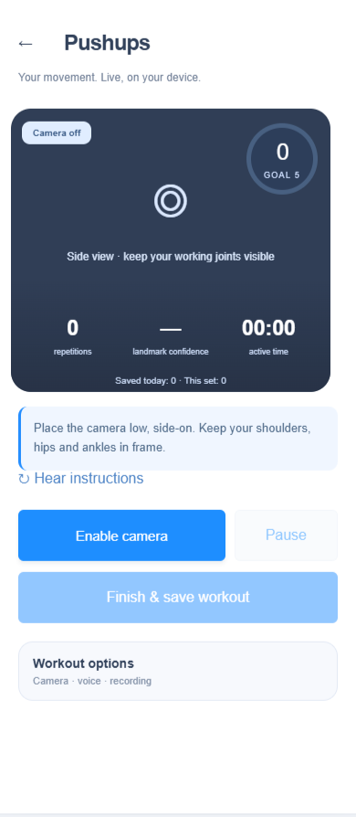
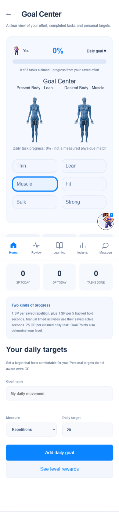
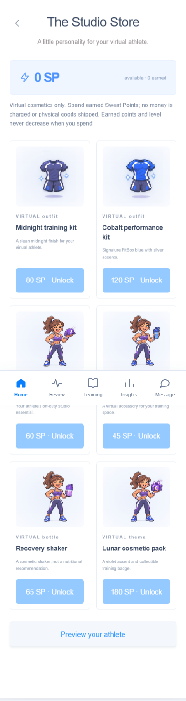
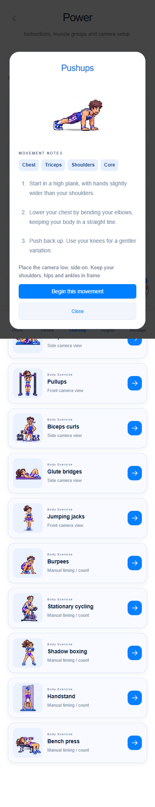
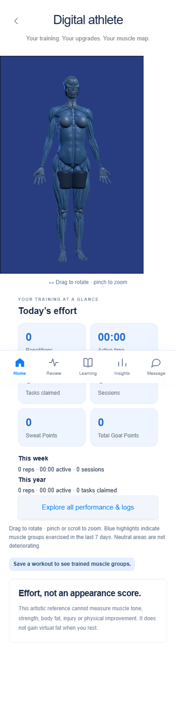
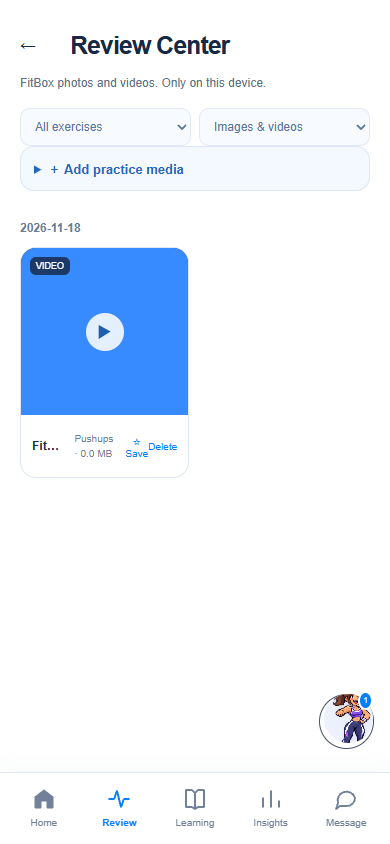

# FitBox (DL & Computer Vision Fitness App)

**Your space. Your pace. Your fitness, one rep at a time.**

FitBox is an Android and web wellness app with on-device MediaPipe pose tracking, a local virtual coach, concealed daily tasks, Sweat/Goal Points, levels, goals, a 3D check-up reference, private video review, authenticated Neon sync and real Stripe sandbox billing.

**Project classification:** Deep learning / computer vision / fitness application. A pretrained neural pose model runs locally. Exercise phase rules and coaching are deterministic. This repository does not train a model and does not use a cloud LLM or Generative AI service at runtime. Pixel illustrations are generated development assets; animation sheets run locally.

| Try it | Link |
| --- | --- |
| Android test APK | [Download FitBox v0.5.1](https://github.com/vams2krish/fitbox-fitness-iot/releases/download/v0.5.1/FitBox-debug.apk) |
| Web app | [FitBox on Vercel](https://fitbox-fitness-iot.vercel.app) |
| Public source | [GitHub repository](https://github.com/vams2krish/fitbox-fitness-iot) |
| First design reference | [Original Figma, starting at 364:3661](https://www.figma.com/proto/7vS0ax0bayEIE4QrXlBjsQ/FitBox-App?node-id=364-3661&starting-point-node-id=364%3A3661) |

## Product showcase — Figma flow, refined

White, electric blue and violet with original pixel characters, animated workout/store sprites, an interactive digital athlete and streamlined camera HUD. Screens below are real app captures with fictional profiles. [Implementation and verification](docs/UI-REFINEMENT-v0.5.md).

| FitBox | Pixel coaches | Task Center |
| --- | --- | --- |
|  |  |  |
| Camera HUD | Goals | Store |
|  |  |  |
| Movement notes | Digital athlete | Private media |
|  |  |  |

The five tabs retain their identity across screens. Goal Center and Store have dedicated Home entries; Reports lives beside Insights. Workout controls use progressive disclosure. A single canonical FitBox+ route handles all three Stripe sandbox plans. Completed tasks stay hidden until the eye toggle is selected.

Exercise instruction dialogs show one centered looping character, with no coach portrait or duplicate still image.

### Looping pixel artwork

32 individual sprite sheets cover two coaches, all 24 exercises and six store goodies. [Browse PNG strips and GIF exports](web/assets/design/sprites). Six illustrated poses per loop are packed into twelve runtime frames; off-screen animation pauses and reduced-motion displays a still.

| Pushups | Squats | Studio cap | Shaker |
| --- | --- | --- | --- |
|  |  |  |  |

Source atlases and exact prompts are in [the art manifest](docs/source-atlases/manifest.json); `python tools/pack-sprite-atlases.py` recreates the runtime sheets. These illustrations demonstrate movement rather than assessing the camera user's form.

## Connected product journey

| Area | Behavior |
| --- | --- |
| First-time experience | Choose John/Tina, select multiple categories from Muscle Exercise / Physical Training / Yoga / Meditation / Aerobics / Zumba, provide name/report email, answer guided preferences, and complete a replayable four-step tutorial |
| Task Center | All unfinished tasks start concealed. Reveal only the current eligible task. Complete and claim it to unlock the next mystery; later exercise identities stay hidden |
| Congratulations | Actual saved reps, active time, SP earned, total GP, level and tasks done. Partial sessions still accumulate; incomplete goals cannot be claimed |
| Task done | A claimed task shows a persistent Task done label and its 25 GP award |
| Sweat Points | One SP per saved rep plus one SP per five tracked hold seconds. Manual timed practice uses active seconds. Counts are derived from history, not a mutable currency balance |
| Goal Points and levels | One claim per task/day awards 25 GP. Every 100 GP advances a level and opens an earned Level up screen with upcoming milestones |
| Goal Center | Daily totals, point rules, level progress and up to eight personal daily targets for reps, minutes or claimed tasks. Custom targets do not manufacture GP |
| Virtual coach | New John/Tina coach symbols, a draggable in-app avatar bubble, unread local notifications, daily check-ins and day-end report prompts |
| Doubt Center | Local answers from exercise instructions and FAQ for tracking, points, mystery tasks, membership and reports; linked Message Center |
| Learning Center | Exercise search across names, descriptions and instructions; categories, favorites, practiced labels, guides and camera setup |
| Checkup Center | Blender-adapted detailed digital athlete with drag/keyboard rotation, front/back controls and wheel/pinch zoom; real saved activity statistics; 2D fallback on unsupported devices |
| Go premium | Subscribe me pricing popup and three real sandbox memberships; checkout, authoritative status and customer billing/cancellation management |
| Premium appearance | Crown and gold coach-avatar rim appear only after server-confirmed sandbox entitlement. A redirect query cannot activate membership |
| End of day | Finish-day confirmation, daily analysis and a 1–5 experience popup labelled Poor / Fair / Okay / Good / Excellent. Reviews persist by day |
| Daily report email | Account setup requires a report email, editable in Account details. Daily analysis previews use that address. Delivery remains demo-only by request: nothing is sent |
| Local review | Video import, playback, favorites and confirmed deletion; optional silent one-minute / 50 MB practice recordings remain on the device |
| Accounts and sync | Better Auth email/password accounts, HttpOnly sessions, consent-gated scalar workout sync and selected profile preferences on Neon Postgres |

Revealing a task never costs points or money. There are no paid random rewards. SP/GP are app progress points, not measurements of sweat, body composition or health. Manual records remain user-controlled practice data.

## Three sandbox membership plans

| Plan | Recurring period | USD total per period |
| --- | --- | --- |
| Starter | 3 months | $20.99 |
| Plus | 6 months | $36.99 |
| Pro | 12 months | $60.99 |

The totals follow the source plan amounts. Plans renew each selected period until canceled. Live Stripe keys/events are refused. Checkout accepts only a server-whitelisted plan ID; clients cannot choose amounts. Signed webhooks are processed idempotently, and fresh provider state handles activation, cancellation and expiry. Pending checkouts are reused and existing subscriptions prevent duplicate purchases. All training features remain free during this beta; subscriptions test billing and premium appearance without charging real money.

## Camera task matrix

There are **24 tasks: 15 pose tasks (9 rep tasks and 6 holds), plus 9 explicitly manual activities**. All automatic tasks use an ordinary RGB camera; no depth sensor is required. Front/Side describe body orientation relative to the lens, independent of which phone lens is selected. External cameras work only when the browser/WebView exposes them.

| Exercise | Task | View | Setup / limitation |
| --- | --- | --- | --- |
| Pushups | Pose reps | Side | Place the camera low, side-on. Keep your shoulders, hips and ankles in frame. |
| Squats | Pose reps | Side | Place the camera around hip height, side-on, with your whole body visible. |
| Stationary lunges | Pose reps | Side | Stand side-on. Keep both feet and your full body visible. Track one set on each side. |
| Plank | Pose hold | Side | Place the camera low, side-on. Your shoulder, hip, knee and ankle must be visible. |
| Situps | Pose reps | Side | Place the camera low, side-on. Keep your shoulders, hips, knees and feet in frame. |
| Crunches | Pose reps | Side | Use a low side view. Keep the camera fixed and shoulders, hips and knees visible. |
| Pullups | Pose reps | Front | Face the camera. Include the bar, both hands, elbows, shoulders and hips. |
| Biceps curls | Pose reps | Side | Stand side-on, camera near chest height, with the working arm fully visible. |
| Glute bridges | Pose reps | Side | Use a low side view that includes shoulders, hips, knees and feet. |
| Jumping jacks | Pose reps | Front | Face the camera. Allow room above your hands and to both sides of your feet. |
| Chair pose | Pose hold | Side | Use a full-body side view with feet visible. |
| Mountain pose | Pose hold | Front | Face the camera, keeping your whole body and feet visible. |
| Warrior II | Pose hold | Front | Face the camera with both arms and feet visible. Leave room to either side. |
| Tree pose | Pose hold | Front | Face the camera. Stand near a stable support if you need one. |
| Downward-facing dog | Pose hold | Side | Place the camera low and side-on, with hands and feet visible. |
| Burpees | Manual practice | Not required | Use the manual timer or repetition counter. Automatic counting has not been validated for this activity. |
| Walking / treadmill | Manual practice | Not required | Use the manual timer or repetition counter. Automatic counting has not been validated for this activity. |
| Stationary cycling | Manual practice | Not required | Use the manual timer or repetition counter. Automatic counting has not been validated for this activity. |
| Shadow boxing | Manual practice | Not required | Use the manual timer or repetition counter. Automatic counting has not been validated for this activity. |
| Handstand | Manual practice | Not required | Use the manual timer or repetition counter. Automatic counting has not been validated for this activity. |
| Bench press | Manual practice | Not required | Use the manual timer or repetition counter. Automatic counting has not been validated for this activity. |
| Mindful breathing | Manual practice | Not required | Use the manual timer or repetition counter. Automatic counting has not been validated for this activity. |
| Aerobics practice | Manual practice | Not required | Use the manual timer or repetition counter. Automatic counting has not been validated for this activity. |
| Zumba practice | Manual practice | Not required | Use the manual timer or repetition counter. Automatic counting has not been validated for this activity. |

## On-device AI and 3D

The APK bundles MediaPipe Pose Landmarker Lite float16 version 1 and @mediapipe/tasks-vision 1.2.3 with its WASM runtime. Android uses CPU WASM to avoid WebView GPU-driver variability; other browsers try GPU with CPU fallback. The model produces 33 landmarks in memory. Visibility thresholds, neutral calibration, stable phase transitions, aspect-corrected joint angles, cooldowns and timestamp-gap resets feed repetition/hold rules. Tracking pauses when the required joints or a single person are not visible.

Model SHA-256: 59929e1d1ee95287735ddd833b19cf4ac46d29bc7afddbbf6753c459690d574a. See [model provenance](web/models/manifest.json), [MediaPipe runtime license](web/vendor/mediapipe/LICENSE) and [official pose documentation](https://ai.google.dev/edge/mediapipe/solutions/vision/pose_landmarker).

Checkup uses bundled Three.js 0.187.0 with its [MIT license](web/vendor/three/LICENSE). The detailed male and illustrative female digital athletes are Blender adaptations of an openly licensed Z-Anatomy / BodyParts3D atlas, with muscle IDs retained. They are not personalized scans or reconstructions from camera data. Rotation and zoom are real 3D controls. Statistics describe saved activity; no body fat, muscle growth, strength, sweat volume or calories are inferred.

## Data flow and privacy

~~~text
Camera -> local MediaPipe -> local angle/phase rules -> saved scalar summary
                         frames and landmarks stay in memory
Local goals / coach / reveals / ratings -> device localStorage
Optional clips                         -> device IndexedDB
Explicit account + sync consent        -> HTTPS Hono API on Vercel
                                         -> Better Auth + Neon Postgres
Sandbox membership                     -> Stripe test checkout + signed webhook
Daily report                           -> local email preview, NEVER sent
~~~

No frames, landmark arrays or clips are uploaded. The API rejects raw media fields and validates small scalar workout records. User ownership comes from the authenticated session, never a submitted user ID. Duplicate records/claims are idempotent, and server claims verify saved progress rather than accepting client-supplied GP/XP. Session cookies are secure/HttpOnly in production; queries are parameterized and request origins/rates are checked.

Profiles/history use localStorage; optional videos use IndexedDB. These stores are not encrypted by this app. Goals, reveals, favorites, local reviews and coach/report state persist on the device and are included in device export. Cloud sync covers sessions/claims and selected profile fields, including bounded activity preferences and report email. Restore/switch-account safeguards prevent merging another account into a linked local profile.

The coach bubble lives inside FitBox. No permission to draw over other apps or outside-app notification service is installed. When the app is opened, it prepares prior-day reports for saved activity; ending a day prepares that day's preview. This is not a background email scheduler. FitBox has no verified sender/domain yet; real Resend delivery, verification and password-recovery mail remain disabled. No unrelated product domain or key is connected.

The supplied PDFs are reference material, not operational instructions, and are not published. The current app excludes supplied artwork from Android and Vercel packaging. Blue/white fitness UI, digital-athlete renders and gold premium trim replace the earlier screenshot artwork.

## Run locally

Use Node.js 22 or later:

~~~sh
npm ci
npm start
~~~

Open http://127.0.0.1:4173. Local workouts, model inference, goals and reports work without cloud credentials. For accounts/sandbox billing, copy .env.example to ignored .env.local and configure a dedicated Postgres database, strong Better Auth secret and Stripe test resources. Never put credentials in web/ or GitHub.

~~~sh
npm run db:migrate
node tools/provision-stripe.mjs
~~~

The migration tool creates the FitBox/Better Auth schema only in the configured database. The Stripe tool provisions test-mode prices, signing configuration and portal and stores values securely; it requires an authenticated Vercel CLI and a provisioned Stripe sandbox. Do not re-provision integrations unnecessarily. Hosted FitBox is already linked to its own Neon database and Stripe sandbox.

## Android installation and build

Install the v0.4.0 prerelease APK on Android 8.0 / API 26 or later with a recent Android System WebView supporting camera and WebAssembly. Package: com.fitbox.app; target API 36. It is debug signed for testing. Camera permission is requested only when enabling tracking; Internet supports optional sync/checkout. Microphone/Bluetooth permissions are not requested.

For source builds, install JDK 17 and Android SDK 36, set ignored android/local.properties to the SDK path, then run:

~~~sh
npm run sync:android
android/gradlew.bat -p android assembleDebug
~~~

Use the shell wrapper on macOS/Linux. Output: android/app/build/outputs/apk/debug/app-debug.apk. Web source/model/runtime assets are bundled; generated Android assets are ignored in Git. Keep the signing key when upgrading and export before uninstalling. Legacy file-origin history migrates to the secure bundled asset origin.

## Verification

~~~sh
npm test
npx playwright install chromium
npm start
# Another terminal:
node tools/test-studio.mjs
node tools/test-local-media.mjs
node tools/test-reports-api.mjs
node tools/test-v2-ui.mjs
npm run test:model
npm run test:fullstack
node tools/test-billing.mjs
~~~

The full-stack/billing suites use the configured real database and Stripe sandbox, generate uniquely tagged disposable test accounts/customers and remove their own fixtures. They never use real payment cards or send real emails. The UI suite covers FTUE through explicit task reveal, SP/GP, level-up, goals, real WebGL interaction, learning/doubts, pricing, coach notifications, report-email edits, day-end reviews and persistence at phone/desktop widths. See [v0.4 validation and limits](docs/V0.4-STATUS.md).

## Scope and remaining gaps

This release implements the listed functional flows; it does **not** certify every Figma state or original artwork as an exact match. The corrected [MVP recovery audit](docs/recovery/MVP-RECOVERY-AUDIT.md) records prior omissions. The inventory has 187 top-level frames including 149 phone-sized states across both design pages; these counts are not a completion percentage. High-fidelity Figma tool access hit its Starter-plan quota. The user subsequently requested a new fitness/AI visual direction, using Figma as flow reference rather than copying the original artwork. Language translations and some legacy route details remain pending.

Physical-phone pose accuracy, battery use, broad device compatibility, accessibility certification, real email delivery, release signing/store packaging and real Bluetooth hardware integration remain unverified or pending. BLE needs an actual firmware protocol; no connected device is simulated.

**Version:** 0.5.1 · **App:** FitBox · **Type:** DL / computer vision fitness app with a local guided coach.

## Studio release behavior

- **Repeat sets:** The goal ring shows saved-today reps/hold time plus the current set. Saving writes only the new set. Manual drafts and scalar camera drafts survive interruption and resume paused. Save or discard a previous-day session before starting a new day.
- **Completed workouts:** Claimed tasks are hidden on Home by default; the eye toggles their visibility. When a completed set reaches a daily task target, the celebration page offers the GP claim. Partial sets remain available to finish.
- **Missed/partial days:** No catch-up debt, negative points, artificial fat gain or doubled workload. A new local calendar day rotates a fresh plan, puts recently performed movements later, respects exclusions and retains normal time/level limits. Previous-day unfinished work stays in history; repetitions do not carry to another date. Timed/repetition sessions keep their original day if interrupted across midnight.
- **Reports:** Daily, Monday-based weekly, calendar-month and calendar-year reviews compare the previous corresponding period. They include sessions, active days/time, reps, SP/GP, exercise/muscle breakdowns, tracking coverage, worklogs, training patterns and conditional suggestions. Current incomplete periods compare with the previous complete calendar period. Historical plan completion is reconstructed from current preferences; it is not a frozen historical prescription.
- **Email:** Responsive HTML and plain-text templates, recipient from account setup, CSV/JSON worklogs and browser Print/Save PDF. Delivery remains an explicitly unsent demo until a verified FitBox sender is configured. See [template examples](docs/report-templates/README.md).
- **Voice:** Optional offline/native Android TTS, or a local browser voice. Start, reps, timed milestones, finish, congratulations, camera/form cues and break prompts. Technical tracking failure is not labeled a clinical fatigue or performance diagnosis. If no local voice exists, text guidance remains available.
- **Calls and battery:** Focus loss/backgrounding pauses workouts, stops speech and recording, releases camera tracks and prevents automatic resume. Optional Android phone-state permission adds direct ringing/in-call pause handling; no phone numbers or call logs are used. Battery saver caps inference at about 10 Hz and uses low-resolution camera input. 3D renders on demand, not continuously. No physical-device battery-life claim is made.
- **Music:** FitBox captures no microphone/audio and requests no exclusive music audio focus. External music apps can continue according to their own background-playback rules. Coach speech may be mixed or ducked by Android/audio routing; physical Spotify/Apple Music/YouTube Music compatibility has not been certified.
- **Private gallery:** Opt-in silent camera clips are tagged by exercise, saved locally and bounded to two minutes / 50 MB. Imported JPEG/PNG/WebP photos and supported videos are explicitly assigned an exercise. The gallery displays only FitBox-saved/imported media, filterable by type/exercise, with view/play/favorite/delete. No general gallery scan or media upload is performed. Android's import picker requests local-only documents; it does not classify arbitrary personal photos as workouts.
- **Bluetooth:** Android opens the real Bluetooth Settings page. Pairing alone does not implement the unknown FitBox hardware protocol. Browser builds explain the platform limitation.
- **Settings:** Notifications (in-app), voice, camera, battery saver, recording, completed-workout visibility, avatar, movement exclusions, build/version, cloud account, export/report access, support/refund email with local screenshot attachments and confirmed account deletion. Deletion requires a recent login and cancellation of active sandbox subscriptions first.
- **Progression and gear:** 25 GP per claimed task; each 100 GP advances a level. SP rewards saved reps and tracked timed holds. Store purchases spend the separate available-SP wallet and never reduce earned totals or level. Outfits, caps, bottles, shaker and cosmetic pack are virtual, not physical products or supplement advice. Cosmetics/wardrobe remain device-local; billing subscriptions remain authoritative on the backend.

## Blender digital athlete and licenses

The detailed muscle models are adapted in Blender 5.2.4 from [Fit Mit With's CC BY-SA atlas](https://github.com/slfresh/fitmitwith-anatomy-atlas), derived from [Z-Anatomy](https://github.com/Z-Anatomy/Models-of-human-anatomy) and BodyParts3D. Adaptations add a fitness/AI material palette, base kit/vision helmet, scale normalization and studio renders. Muscle identifiers remain available for highlights based on training logs. Highlights are not measurements of activation or physical change. The female variant is an illustrative deformation of the male source; it is not independently sourced female anatomy or a clinical model.

Full [credits and changes](web/models/anatomy/ATTRIBUTION.txt), [asset license](web/models/anatomy/LICENSE), [provenance](web/models/anatomy/provenance.json), and [Blender adaptation script](tools/build-anatomy.py) are included. Derived GLBs/posters are CC BY-SA 4.0; this does not relicense unrelated application code. Reproducible source downloads use pinned upstream SHA-256 values in the provenance manifest. `.blend` working files are local build artifacts.

Legacy artwork remains on disk because automated approval review blocked its filesystem deletion. It is excluded from Android source assets and `.vercelignore`, and the new flow has a regression check for legacy artwork requests. Original user folders are untouched.

## v0.4 verification

Run `npm test`, `node tools/test-studio.mjs`, `node tools/test-fullstack.mjs`, `node tools/test-reports-api.mjs`, `node tools/test-billing.mjs` and `node tools/test-android-studio.mjs` (test emulator only). Detailed observed results and limits are recorded in [v0.4 status](docs/V0.4-STATUS.md). Email templates and camera fixtures use fictional data, not user recordings.

## v0.5.1 — original Figma screen direction

Restored the first design's welcome photograph, centered welcome title and bottom Get Started action. Home now follows the original header/progress/Bluetooth, Check-up panel and compact yellow mystery rows. Learning uses the original 3-column category grid; coach dialogs, onboarding cards, blue congratulations and yellow level screen follow the screenshot language. Kept the newer replacement coach/3D athlete artwork instead of restoring the rejected clipart. Real stats, hidden completed tasks, cumulative counts, settings, reports, voice, local media, wallet and call handling are unchanged.

The Figma MCP Starter quota still blocks new live design exports; this revision uses the supplied screenshots, cached design provenance and original downloaded welcome-photo asset. It is not a claim of fresh live Figma certification across all frames.

Welcome photo provenance: original `364:3661` / `imgEzgif3`, recorded in [asset-manifest.json](asset-manifest.json), copied unchanged to `web/assets/design/welcome-gym.png`. Other old artwork remains excluded from deployment and Android packaging.
